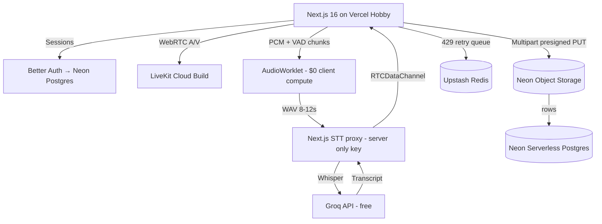

# 🎙️ Synthetix Engine

**A browser-based live studio** — multi-guest WebRTC rooms, real-time AI captions, and cloud recordings — engineered to run on a **\$0/month free-tier stack** (Neon · Vercel · LiveKit · Groq · Upstash · Better Auth).

> **Status:** Phase 4 complete ✅ — studio UI verified in a real browser (pre-join → grid → controls → responsive transcript shell). Building Phase 5 (live captions). Build plan and rules live in [`AGENTS.md`](./AGENTS.md).

---

## Why this project exists

Demo calls, podcasts, and remote interviews need: multi-guest video, live captions, and a recording — usually \$50–200/mo across 5 vendors. Synthetix Engine proves a coherent product can run on free tiers **if you engineer around the limits instead of ignoring them** (rate-limit-aware chunking, client-side recording, quota guardrails).

## Highlights

- **Verified free-tier budget math.** Every external limit in this repo is cited from vendor docs (checked Nov 2026) — see [`architecture.md`](./docs/architecture.md#free-tier-budget).
- **A rate-limit-aware STT pipeline.** VAD-based chunking engineered against Groq Whisper's *20 RPM / 2,000 req/day / min-10s-billable* caps. The original fixed 2-second chunk design would have stalled even a single speaker (see [Errata](#errata-vs-the-original-blueprint)).
- **\$0 recordings.** Client-side `MediaRecorder` → multipart presigned uploads, because LiveKit's free tier only includes **60 transcode-minutes/month** (their Egress is effectively unusable for free).
- **Branch-preview environments where DB *and* media files fork together** (Neon Object Storage copy-on-write) — no shared test bucket, no stale fixtures.
- **A full engineering doc set** the way a staff engineer would write it: PRD → architecture + ADRs → RBAC → conventions → quality gates → PR rules.

## Architecture



## Stack — verified free-tier limits (Nov 2026)

| Layer | Service | Free-tier limits (verified) | Cost |
|---|---|---|---|
| Hosting / Edge | **Vercel** Hobby | 100 GB bandwidth/mo, Server Actions & route handlers | \$0 |
| Auth | **Better Auth** (self-hosted) | Runs inside Next.js API routes; Postgres via Prisma adapter | \$0 |
| Database | **Neon** Serverless Postgres | 0.5 GiB storage, scale-to-zero, instant branching | \$0 |
| Object Storage | **Neon Object Storage** (GA Sep 2026) | 5 GB/project, S3-compatible, branches with your DB, multipart to 10 GiB | \$0 |
| Realtime SFU | **LiveKit Cloud** Build | 5,000 WebRTC participant-min/mo, 50 GB downstream/mo, 100 concurrent — *hard caps* | \$0 |
| Speech-to-Text | **Groq** `whisper-large-v3-turbo` | 20 RPM · 2,000 req/day · 7,200 audio-s/hour · 28,800 audio-s/day · min 10 s billable · 25 MB max | \$0 |
| Queue / Rate-limit | **Upstash** Redis | 10,000 commands/day | \$0 |

> ⚠️ LiveKit's free plan is a **hard cap**: exceeding it makes new sessions *fail* (no overage billing). The app must preflight and guard quotas — see [`architecture.md`](./docs/architecture.md#free-tier-budget).

## What \$0 actually buys you (budget math)

| Resource | Budget | Realistic capacity |
|---|---|---|
| LiveKit participant-minutes | 5,000/mo | A 4-person room runs **~20 room-hours/month** ≈ one 45-min demo session/day |
| LiveKit downstream | 50 GB/mo | ~23 room-hours at 720p; 360p grid thumbnails stretch it further |
| Groq transcription | 2,000 req/day, ≥10 s billable each | **~5.5 hours of audio/day** transcribed (VAD chunks, active speaker only) |
| Neon Postgres | 0.5 GiB | Thousands of rooms/transcript rows |
| Neon Object Storage | 5 GB/project | ~5 × 30-min 720p recordings, then prune |
| Vercel bandwidth | 100 GB/mo | Transcript payloads are KBs; media bypasses Vercel (direct-to-storage) |
| Upstash | 10k cmds/day | ~2–3 rate-limit checks per request + retry-queue traffic |

## Repository map

| Doc | Purpose |
|---|---|
| [`AGENTS.md`](./AGENTS.md) | **AI context hub** — rules, verified facts, references. Read first. |
| [`synthetix-engine-prd.md`](./docs/synthetix-engine-prd.md) | Product requirements, P0/P1/P2, metrics, non-goals |
| [`architecture.md`](./docs/architecture.md) | System design, ADRs, budgets, failure modes |
| [`realtime-media-pipeline.md`](./docs/realtime-media-pipeline.md) | Capture → VAD → Groq → captions → recording flow |
| [`database-and-security.md`](./docs/database-and-security.md) | Schema, indexes, auth hardening, secrets, threats |
| [`rooms-roles-and-rbac.md`](./docs/rooms-roles-and-rbac.md) | Roles, permission matrix, moderation, room lifecycle |
| [`design-spec.md`](./docs/design-spec.md) | Design tokens, layout, states, accessibility |
| [`nextjs-conventions.md`](./docs/nextjs-conventions.md) | App Router rules for this codebase |
| [`code-complexity-and-quality.md`](./docs/code-complexity-and-quality.md) | Complexity budgets, tests, CI gates, DoD |
| [`pull-request-guidelines.md`](./docs/pull-request-guidelines.md) | PR size, checklist, merge rules |
| [`GITFLOW.md`](./docs/GITFLOW.md) | Trunk-based branching + Neon preview branches |
| [`subagent-team.md`](./docs/subagent-team.md) | How AI agents collaborate on this repo |
| [`BLUEPRINT-ORIGINAL.md`](./docs/BLUEPRINT-ORIGINAL.md) | Raw original idea — superseded by these docs (see errata) |

## Quickstart

```bash
# 1. Prereqs: Node 20+, a Neon project, LiveKit project, Groq key, Upstash store
cp .env.example .env.local   # fill in values
npm install                  # already done if scaffolded
npm run db:migrate           # apply prisma/migrations to your Neon branch
npm run dev                  # http://localhost:3000
```

Fill `.env.local` (pooled `DATABASE_URL`, LiveKit key/secret/URL), run `npm run db:migrate`, then `npm run dev`. Verify the wiring with `npm run db:smoke`; continue with [`AGENTS.md`](./AGENTS.md) → Phase 4.

## Implementation status

| Phase | Deliverable | Status |
|---|---|---|
| 0 | Engineering doc set (this repo) | ✅ |
| 1 | Next.js scaffold + deps + env template | ✅ |
| 2 | Auth (Better Auth) + Prisma schema on Neon | ✅ live — sign-up/sign-in verified |
| 3 | Rooms: create/join + LiveKit token issuance | ✅ verified — create/admit/token on real Neon + LiveKit |
| 4 | Studio UI: video grid, controls, transcript rail | ✅ verified — pre-join, grid, mic/cam controls, responsive transcript rail |
| 5 | STT pipeline: worklet → VAD → Groq → DataChannel | ⬜ |
| 6 | Recording: MediaRecorder → multipart presigned upload | ⬜ |
| 7 | Quota guards, rate limits, error/empty states | ⬜ |
| 8 | Tests, CI, README demo GIF | ⬜ |

## Errata vs the original blueprint

`BLUEPRINT-ORIGINAL.md` is kept for provenance. These corrections are binding:

| # | Original claim | Correction |
|---|---|---|
| 1 | LiveKit free = "1k participant-minutes" | **5,000** participant-min/mo + 100 concurrent + 50 GB downstream (hard caps) — [LiveKit quotas](https://docs.livekit.io/deploy/admin/quotas-and-limits/) |
| 2 | Slice PCM into **2-second** `.wav` chunks | Infeasible: 20 RPM can't sustain realtime at 2 s chunks (needs 30 RPM), and min-10 s billing burns the daily budget in **~67 min audio**. Use **VAD chunks, 8–12 s, active speaker only** |
| 3 | Groq called from the browser | **Never.** Key is server-only; browser posts to `/api/stt/transcribe` |
| 4 | `Recording.fileUrl` stored in DB | Presigned URLs expire. Store `storageKey` only; sign GET on read after authz |
| 5 | Neon storage endpoint `us-east-1` | Beta/GA launched in **us-east-2 (Ohio)** — copy the endpoint from your Neon console |
| 6 | `tailwind.config.js` in repo layout | Tailwind v4 config lives in `app/globals.css` (`@theme`) — no JS config file |
| 7 | Full DSP chain (EQ/noise-cancel/gain) in worklet | Cut: browsers ship WebRTC APM via `getUserMedia` constraints. Worklet does **level metering + VAD only** |
