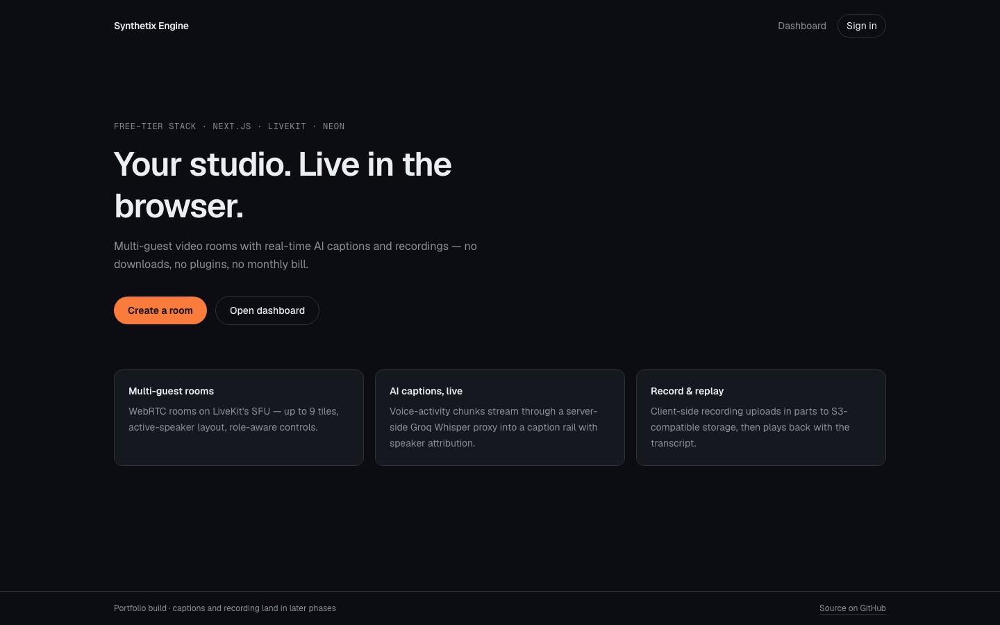
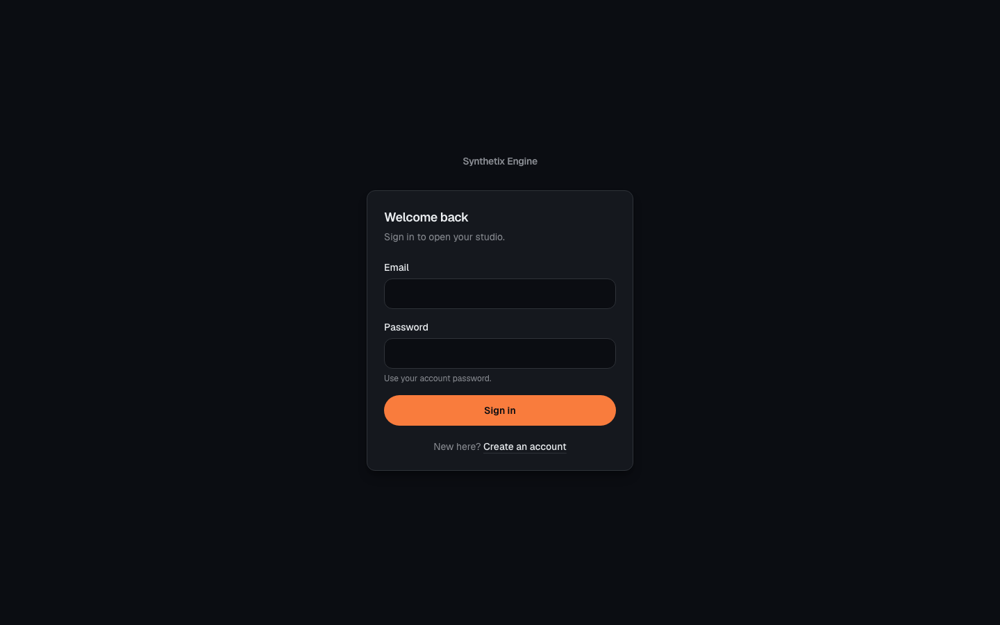

<div align="center">

# 🎙️ Synthetix Engine

**A browser-based live studio — multi-guest WebRTC rooms, real-time AI captions, and cloud recordings, engineered to run on a \$0/month free-tier stack.**

[](https://github.com/Ankitbhalke137/synthetix-engine/actions/workflows/ci.yml)
[](https://github.com/Ankitbhalke137/synthetix-engine/actions/workflows/deploy.yml)
[](https://github.com/Ankitbhalke137/synthetix-engine/actions/workflows/codeql.yml)
[](./LICENSE)
[](https://synthetix-engine.vercel.app)

[**Live demo**](https://synthetix-engine.vercel.app) · [**Contributing**](./docs/CONTRIBUTING.md) · [**Report a bug**](https://github.com/Ankitbhalke137/synthetix-engine/issues/new?template=bug_report.yml) · [**Request a feature**](https://github.com/Ankitbhalke137/synthetix-engine/issues/new?template=feature_request.yml)

</div>

---

## Screenshots

| Landing | Sign in |
|---|---|
|  |  |

> The studio itself needs a camera and microphone, so its screenshots are
> captured per the steps in [`docs/linkedin-post.md`](./docs/linkedin-post.md#how-to-capture-the-studio-screenshots-36).

---

## Status

**Phase 8 complete — tests + CI/CD ✅.** The app is deployed and building clean:
`tsc` ✅ · `lint` ✅ · 71 tests ✅ · `next build` ✅ · CI on every PR ✅.
The only optional leftover is a short demo GIF.

---

## Why this project exists

Demo calls, podcasts, and remote interviews need three things: multi-guest
video, live captions, and a recording. Most stacks charge \$50–200/month across
five vendors. On free tiers, the usual move is to ignore the limits until they
break you.

Synthetix Engine takes the opposite approach: **design around the free-tier
limits instead of ignoring them.** It is also a deliberate engineering
portfolio: requirements → architecture + ADRs → security → quality gates → CI →
CD, all documented before and alongside the code.

## Features

**Studio**

- Email/password authentication with sessions (Better Auth).
- Create a room, copy the invite link, and join from the browser with zero installs — signed-in teammates directly, guests by display name.
- Multi-guest WebRTC video via LiveKit — active-speaker grid, up to 9 tiles.
- Role-aware access: host, moderator, participant, viewer (enforced on tokens and storage).
- Host/moderator moderation: mute, remove, and end the room — enforced server-side and written to the audit log.
- Pre-join device check, mic/camera controls, level meter, keyboard shortcuts.
- Responsive transcript rail that becomes a bottom sheet on small screens.

**AI captions**

- Voice-activity detection in an `AudioWorklet` — audio never blocks the UI.
- 8–12 s active-speaker chunks tuned to Groq Whisper's rate limits.
- Server-only STT proxy (`/api/stt/transcribe`) — the Groq key never reaches the
  browser.
- Captions broadcast to every guest over a LiveKit DataChannel.
- Transcripts persisted with speaker attribution and idempotent sequence numbers.

**Recording and playback**

- Client-side `MediaRecorder` + multipart presigned uploads — no paid egress.
- Direct-to-storage uploads bypass Vercel bandwidth.
- Authorized playback page (`/dashboard/rooms/[roomId]`) with per-request presigned GETs.
- Session transcript replay with speaker attribution and timestamps.
- Storage keys stored in Postgres; URLs are signed on read, never persisted.

**Trust and guardrails**

- Quota preflight against LiveKit's hard free-tier cap.
- Upstash rate limits on the STT proxy (per user and per room).
- Visible budget chip so users see remaining quota before they hit it.
- Server-side authorization re-derived from the database on every request.

**Engineering**

- TypeScript strict, no `any`, no `console.log` in shipped paths.
- 71 Vitest tests across quota math, VAD, tokens, routes, auth, and rooms.
- GitHub Actions CI: lint, typecheck, tests, Prisma validation, production build.
- CodeQL scanning, Dependabot updates, issue/PR templates, Code of Conduct.

---

## Architecture


### Key decisions (ADRs in [`docs/architecture.md`](./docs/architecture.md))

- **VAD chunks, not fixed slices.** 20 RPM and a 10 s minimum bill make 2 s
  chunks infeasible; VAD 8–12 s active-speaker chunks fit the budget.
- **Client-side recording.** LiveKit's free tier includes only 60 transcode
  minutes/month, so `MediaRecorder` + presigned multipart uploads replaces Egress.
- **Server-only vendor calls.** Groq, LiveKit server SDK, and the S3 SDK are
  never imported by client components.
- **Sign on read.** Presigned URLs expire, so only `storageKey` is persisted.
- **Quota preflight.** LiveKit's free plan is a hard cap — new sessions fail
  rather than bill overage, so the app blocks before it exceeds the budget.

---

## Tech stack — verified free-tier limits (Nov 2026)

| Layer | Service | Free-tier limits (verified) | Cost |
|---|---|---|---|
| Hosting / edge | **Vercel** Hobby | 100 GB bandwidth/mo, route handlers, server actions | \$0 |
| Auth | **Better Auth** (self-hosted) | Runs in Next.js API routes; Postgres via Prisma adapter | \$0 |
| Database | **Neon** Serverless Postgres | 0.5 GiB storage, scale-to-zero, instant branching | \$0 |
| Object storage | **Neon Object Storage** | 5 GB/project, S3-compatible, branches with your DB, multipart to 10 GiB | \$0 |
| Realtime SFU | **LiveKit Cloud** Build | 5,000 participant-min/mo, 50 GB downstream/mo, 100 concurrent — *hard caps* | \$0 |
| Speech-to-text | **Groq** `whisper-large-v3-turbo` | 20 RPM · 2,000 req/day · 28,800 audio-s/day · min 10 s billable · 25 MB max | \$0 |
| Queue / rate limit | **Upstash** Redis | 10,000 commands/day | \$0 |

**Application stack:** Next.js **16.4.6** (App Router) · React **19** ·
TypeScript strict · Tailwind CSS **v4** · Prisma **7** with
`@neondatabase/serverless` · AWS S3 SDK (Neon endpoint) · Vitest · GitHub
Actions.

> ⚠️ LiveKit's free plan is a **hard cap**: exceeding it makes new sessions
> fail (no overage billing). The app preflights and guards quotas.

## What \$0 actually buys you

| Resource | Budget | Realistic capacity |
|---|---|---|
| LiveKit participant-minutes | 5,000/mo | A 4-person room runs **~20 room-hours/month** ≈ one 45-min demo/day |
| LiveKit downstream | 50 GB/mo | ~23 room-hours at 720p; 360p thumbnails stretch it further |
| Groq transcription | 2,000 req/day, ≥10 s billable | **~5.5 hours of audio/day** with VAD active-speaker chunks |
| Neon Postgres | 0.5 GiB | Thousands of rooms and transcript rows |
| Neon Object Storage | 5 GB/project | ~5 × 30-min 720p recordings, then prune |
| Vercel bandwidth | 100 GB/mo | Transcript payloads are KBs; media bypasses Vercel |
| Upstash | 10k commands/day | ~2–3 rate-limit checks per request |

---

## Quickstart

### Prerequisites

- Node.js **20.9+** (Node 22 LTS also works)
- Free-tier accounts: [Neon](https://neon.com), [LiveKit](https://livekit.io),
  [Groq](https://console.groq.com), [Upstash](https://upstash.com)
- Optional: [Vercel](https://vercel.com) for deployment

### Run locally

```bash
git clone https://github.com/Ankitbhalke137/synthetix-engine.git
cd synthetix-engine

npm ci
cp .env.example .env.local     # fill in the values (see below)
npx prisma generate
npm run db:migrate             # apply migrations to your Neon branch
npm run dev                    # http://localhost:3000
```

Verify the wiring:

```bash
npm run db:smoke               # is DATABASE_URL reachable and migrated?
```

> **Port matters.** Better Auth validates the request origin against
> `BETTER_AUTH_URL`. If you run on another port (`npm run dev -- -p 3001`), set
> `BETTER_AUTH_URL` to match or sign-in fails with “Invalid origin”.

### Environment variables

Copy [`.env.example`](./.env.example) and fill these in:

| Variable | Where to get it | Notes |
|---|---|---|
| `DATABASE_URL` | Neon console | **Pooled** connection string (`ep-…-pooler`) |
| `BETTER_AUTH_SECRET` | `openssl rand -base64 32` | ≥ 32 random bytes |
| `BETTER_AUTH_URL` | Your origin | `http://localhost:3000` locally; exact deployed URL in production |
| `NEON_STORAGE_ENDPOINT` | Neon console | S3-compatible endpoint |
| `NEON_STORAGE_ACCESS_KEY_ID` / `NEON_STORAGE_SECRET_ACCESS_KEY` | Neon console | Scoped storage credentials |
| `NEON_STORAGE_BUCKET_NAME` | You | e.g. `synthetix-recordings` |
| `NEON_STORAGE_REGION` | Neon console | Match the endpoint region (this deployment: `ap-southeast-1`) |
| `LIVEKIT_API_KEY` / `LIVEKIT_API_SECRET` | LiveKit Cloud console | Server only |
| `NEXT_PUBLIC_LIVEKIT_URL` | LiveKit Cloud console | Public WebSocket URL — not a key |
| `GROQ_API_KEY` | Groq console | Server only; used by the STT proxy |
| `UPSTASH_REDIS_REST_URL` / `UPSTASH_REDIS_REST_TOKEN` | Upstash console | Rate limiting |

Never commit real values. `.env.local` is gitignored; `.env.example` is the
canonical template.

### Scripts

| Command | What it does |
|---|---|
| `npm run dev` | Start Next.js in development |
| `npm run build` | Production build (includes typecheck) |
| `npm start` | Serve the production build |
| `npm run lint` | ESLint |
| `npm test` | Run the Vitest suite |
| `npm run test:watch` | Vitest in watch mode |
| `npm run typecheck` | Generate Next.js route types and typecheck |
| `npx prisma generate` | Regenerate the client (also runs on install) |
| `npm run db:validate` | Validate `schema.prisma` |
| `npm run db:migrate` | Create/apply migrations in development |
| `npm run db:deploy` | Apply migrations in CI/production |
| `npm run db:smoke` | Check database reachability and schema |

---

## Testing and quality gates

```bash
npm run lint && npm run typecheck && npm test && npm run build
```

The suite covers quota math and fail-open behavior, VAD transitions and WAV
encoding, LiveKit token claims, auth routes, room service, and the STT proxy
authorization/rate-limit matrix.

CI runs the same gates in two required jobs — `quality` and `build` — plus
Prisma validation. See [`docs/ci-cd.md`](./docs/ci-cd.md) for the full pipeline.

---

## CI/CD and deployment

- **CI** (`.github/workflows/ci.yml`): lint, typecheck, tests, Prisma
  validation, production build on every push to `main` and every PR.
- **Deploy** (`.github/workflows/deploy.yml`): deploy to Vercel after CI passes
  on `main`. Works with Vercel's Git integration (default) or the CLI when
  `VERCEL_TOKEN` is configured.
- **CodeQL** (`.github/workflows/codeql.yml`): static security analysis.
- **Dependabot** (`.github/dependabot.yml`): weekly npm and Actions updates.

`main` is protected: **pull request required, `quality` + `build` checks
required, linear history, squash merge only, no force-pushes.**

### Deploy your own

1. Push a fork to GitHub.
2. Import the repo in [Vercel](https://vercel.com/new) (Next.js is auto-detected).
3. Add the environment variables above, with `BETTER_AUTH_URL` set to your exact
   deployed URL.
4. Deploy. For CLI/CD deploys, add `VERCEL_TOKEN` as a repository secret — see
   [`docs/ci-cd.md`](./docs/ci-cd.md).

Full deployment details, secrets, and troubleshooting:
[`docs/ci-cd.md`](./docs/ci-cd.md).

---

## Contributing

Contributions are welcome — with a few guardrails so the project stays honest.

1. Read [`docs/CONTRIBUTING.md`](./docs/CONTRIBUTING.md).
2. Pick an issue (or open one first for anything non-trivial).
3. Branch from `main` with a conventional name (`feat/…`, `fix/…`, `docs/…`).
4. Keep PRs ≤ 400 changed lines, one concern, docs updated with code.
5. Make CI green — `quality` and `build` must pass.

**Good first issues** are labelled
[`good first issue`](https://github.com/Ankitbhalke137/synthetix-engine/labels/good%20first%20issue).
By participating you agree to the
[Code of Conduct](./docs/CODE_OF_CONDUCT.md). Please report security issues
privately per the [Security Policy](./docs/SECURITY.md).

---

## Project structure

```
app/                 Next.js App Router routes, API handlers, server actions
components/          Auth, dashboard, and studio UI
lib/                 Auth, env, Prisma, rooms, quota, rate limit, LiveKit, audio
public/worklets/     AudioWorklet VAD + level meter
prisma/              Schema and migrations
tests/               Integration tests (routes, services, tokens)
docs/                PRD, architecture, ADRs, specs, contributing, CI/CD
.github/             Workflows, issue/PR templates, CODEOWNERS, Dependabot
```

## Documentation map

| Doc | Purpose |
|---|---|
| [`AGENTS.md`](./AGENTS.md) | AI/contributor context hub — rules, verified facts, references |
| [`docs/synthetix-engine-prd.md`](./docs/synthetix-engine-prd.md) | Product requirements, goals, personas, non-goals |
| [`docs/architecture.md`](./docs/architecture.md) | System design, ADRs, budgets, failure modes |
| [`docs/realtime-media-pipeline.md`](./docs/realtime-media-pipeline.md) | Capture → VAD → Groq → captions → recording |
| [`docs/database-and-security.md`](./docs/database-and-security.md) | Schema, indexes, auth hardening, threats |
| [`docs/rooms-roles-and-rbac.md`](./docs/rooms-roles-and-rbac.md) | Roles, permission matrix, moderation |
| [`docs/design-spec.md`](./docs/design-spec.md) | Design tokens, layout, states, accessibility |
| [`docs/nextjs-conventions.md`](./docs/nextjs-conventions.md) | App Router rules for this codebase |
| [`docs/code-complexity-and-quality.md`](./docs/code-complexity-and-quality.md) | Complexity budgets, tests, gates, DoD |
| [`docs/pull-request-guidelines.md`](./docs/pull-request-guidelines.md) | PR size, checklist, merge rules |
| [`docs/GITFLOW.md`](./docs/GITFLOW.md) | Branching, commits, Neon preview branches |
| [`docs/ci-cd.md`](./docs/ci-cd.md) | CI/CD pipelines, secrets, branch protection |
| [`docs/CONTRIBUTING.md`](./docs/CONTRIBUTING.md) | How to contribute |
| [`docs/SECURITY.md`](./docs/SECURITY.md) | Security policy and reporting |
| [`docs/CODE_OF_CONDUCT.md`](./docs/CODE_OF_CONDUCT.md) | Community standards |
| [`docs/subagent-team.md`](./docs/subagent-team.md) | How AI agents collaborate here |
| [`docs/BLUEPRINT-ORIGINAL.md`](./docs/BLUEPRINT-ORIGINAL.md) | Raw original idea — superseded by the docs above |

---

## Implementation status

| Phase | Deliverable | Status |
|---|---|---|
| 0 | Engineering doc set | ✅ |
| 1 | Next.js scaffold + dependencies + env template | ✅ |
| 2 | Auth (Better Auth) + Prisma schema on Neon | ✅ verified |
| 3 | Rooms: create/join + LiveKit token issuance | ✅ verified |
| 4 | Studio UI: video grid, controls, transcript rail | ✅ verified |
| 5 | STT pipeline: worklet → VAD → Groq → DataChannel | ✅ verified |
| 6 | Recording: MediaRecorder → multipart presigned upload | ✅ verified |
| 7 | Quota guards, rate limits, error/empty states | ✅ verified |
| 8 | Tests, CI/CD, contributor docs | ✅ 71 tests · CI · CD · CodeQL |
| 8b | Demo GIF | ⬜ optional |

## Errata vs the original blueprint

`BLUEPRINT-ORIGINAL.md` is kept for provenance. These corrections are binding:

| # | Original claim | Correction |
|---|---|---|
| 1 | LiveKit free = “1k participant-minutes” | **5,000** participant-min/mo + 100 concurrent + 50 GB downstream (hard caps) — [LiveKit quotas](https://docs.livekit.io/deploy/admin/quotas-and-limits/) |
| 2 | Slice PCM into **2-second** `.wav` chunks | Infeasible: 20 RPM can't sustain realtime at 2 s chunks (needs 30 RPM), and min-10 s billing burns the daily budget in **~67 min audio**. Use **VAD chunks, 8–12 s, active speaker only** |
| 3 | Groq called from the browser | **Never.** Key is server-only; browser posts to `/api/stt/transcribe` |
| 4 | `Recording.fileUrl` stored in DB | Presigned URLs expire. Store `storageKey` only; sign GET on read after authz |
| 5 | Neon storage endpoint `us-east-1` | Copy the endpoint from your Neon console — do not assume a region |
| 6 | `tailwind.config.js` in repo layout | Tailwind v4 config lives in `app/globals.css` (`@theme`) — no JS config file |
| 7 | Full DSP chain (EQ/noise-cancel/gain) in worklet | Cut: browsers ship WebRTC APM via `getUserMedia` constraints. The worklet does **level metering + VAD only** |

## License

[MIT](./LICENSE) © 2026 Ankit Bhalke.

## Acknowledgements

Built on the generous free tiers of [Vercel](https://vercel.com),
[Neon](https://neon.com), [LiveKit](https://livekit.io),
[Groq](https://groq.com), and [Upstash](https://upstash.com). Thanks to the
maintainers of Next.js, React, Prisma, Better Auth, Tailwind CSS, and Vitest.
