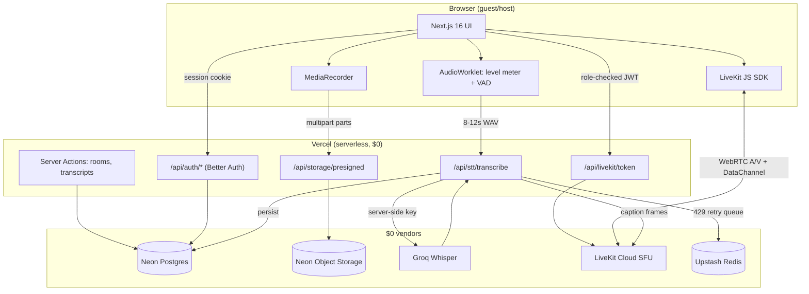
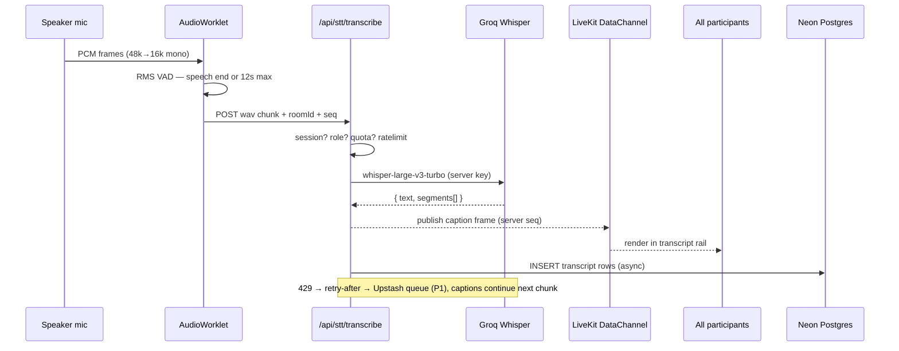
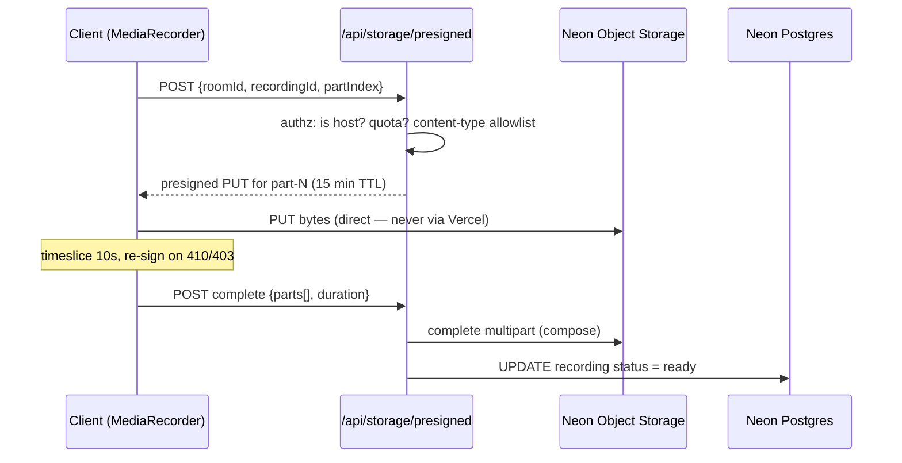

# System Architecture — Synthetix Engine

> Companion ADRs: decisions are numbered **ADR-001…008**; budgets are cited with sources (verified Nov 2026).
> Raw idea: [`BLUEPRINT-ORIGINAL.md`](./BLUEPRINT-ORIGINAL.md) · Product framing: [`synthetix-engine-prd.md`](./synthetix-engine-prd.md)

---

## 1. Context diagram

**Trust boundaries:** the browser is untrusted. Only three things cross it: session cookies (Better Auth), short-lived LiveKit JWTs, and presigned URLs scoped to one object key. Groq/Neon/LiveKit credentials never reach the client.

## 2. Modules

| # | Module | Home | Responsibility | Key doc |
|---|---|---|---|---|
| M1 | Auth & sessions | `lib/auth.ts`, `app/api/auth/[...all]` | Email/password + sessions on Neon Postgres | database-and-security |
| M2 | Rooms & membership | `lib/rooms.ts`, server actions | Create/join, roles, lifecycle | rooms-roles-and-rbac |
| M3 | Realtime transport | LiveKit JS + `api/livekit/token` | A/V routing, DataChannel captions, token minting | realtime-media-pipeline |
| M4 | Audio worklet | `public/worklets/audio-processor.js` | PCM capture, level metering, VAD decisions | realtime-media-pipeline |
| M5 | STT proxy | `api/stt/transcribe` | Session check → quota → Groq → broadcast → persist | realtime-media-pipeline |
| M6 | Recording | `api/storage/presigned` + client recorder | Multipart upload, finalize, playback authz | realtime-media-pipeline |
| M7 | Quota & rate limits | `lib/ratelimit.ts` (Upstash) | Per-user/per-room guards, 429 handling | architecture (§5) |
| M8 | Storage layer | `lib/prisma.ts`, `lib/neon-storage.ts` | Pooled Neon client, S3 presigning | database-and-security |

## 3. Key data flows

### 3.1 Caption flow (speech → screen)

**Latency budget (target ≤ 12 s):** VAD fill 8–12 s (dominant) + Groq ~0.3–1 s + fanout <100 ms. Chunk length is the only knob — see [ADR-003](#adr-003--stt-chunking-vad-812s--fixed-2s-chunks).

### 3.2 Recording flow (mic → storage)

## 4. Architecture Decision Records

### ADR-001 · SFU (LiveKit) vs mesh WebRTC vs self-hosted SFU

**Decision:** LiveKit Cloud (Build plan).
**Why:** mesh breaks past 3 peers (O(n²) uplink); self-hosted SFU means a server with bandwidth — \$0 incompatible. LiveKit gives 5,000 participant-min + 50 GB downstream free with hard caps we can preflight.
**Tradeoff:** vendor lock-in, hard caps, no free Egress (→ ADR-002).
**Revisit when:** sessions > 100 concurrent or caps become a product problem.

### ADR-002 · Client-side MediaRecorder vs LiveKit Egress

**Decision:** `MediaRecorder` in the host browser → multipart presigned upload.
**Why:** LiveKit free plan includes only **60 transcode-minutes/month** — two 30-minute recordings exhaust it. Client recording costs \$0 compute and keeps media off Vercel bandwidth.
**Tradeoff:** recording dies if the host's tab closes; codec varies by browser (MIME allowlist); no server-side composite layout; quality tied to host uplink.
**Mitigations:** clear "keep this tab open" UI, per-part upload + resume, graceful Safari fallback state.
**Revisit when:** we ever pay for LiveKit Ship or need guaranteed server-side capture.

### ADR-003 · STT chunking: VAD 8–12 s vs fixed 2 s chunks

**Decision:** Voice-activity-detected chunks targeting **8–12 s** (hard floor 6 s, flush at 15 s), active speaker only.
**Why (the math):** Groq free Whisper = **20 RPM, 2,000 req/day, min 10 s billable/audio-second, 28,800 audio-s/day**.

| Design | Req/min needed for one continuous speaker | Fits 20 RPM? | Audio transcribed per day (2,000 req cap) | ASD consumed |
|---|---|---|---|---|
| Fixed 2 s (original) | **30** | ❌ stalls immediately | 4,000 s ≈ **67 min** | 20,000 (wastes 80%) |
| Fixed 6 s | 10 | ✅ | 12,000 s ≈ 3.3 h | 20,000 |
| **VAD 8–12 s (chosen)** | ~5–7 | ✅ 3× headroom | ~20,000 s ≈ **5.5 h** | 20,000 ≤ 28,800 ✅ |

**Tradeoff:** caption latency becomes ~8–12 s (acceptable per PRD G1 ≤ 12 s). VAD adds ~40 lines of worklet logic (still simpler than the DSP chain we cut — see ADR-008).
**Revisit when:** Groq raises free limits or we pay for Developer (300 RPM → 2 s chunks viable).

### ADR-004 · Self-hosted Better Auth vs Neon Managed Better Auth

**Decision:** self-hosted `better-auth` inside Next.js route handlers, Prisma adapter → Neon Postgres.
**Why:** full control of schema/session behavior, portable (not coupled to Neon's managed product), matches the showcase story of owning the auth layer.
**Tradeoff:** we own upgrades/fixes; Neon now ships managed Better Auth on branches — a one-line-ish migration path later.
**Revisit when:** auth maintenance cost exceeds its showcase value.

### ADR-005 · Direct presigned uploads vs proxying media through the server

**Decision:** browser → presigned PUT/POST straight to Neon Object Storage.
**Why:** Vercel's 100 GB/mo bandwidth dies instantly if video transits the serverless functions; storage traffic is free and multipart resumable (up to 10 GiB objects).
**Tradeoff:** presign endpoint must be bulletproof on authz (IDOR risk → database-and-security §5), URL TTLs need re-sign logic.
**Never:** stream recordings through Next.js route handlers.

### ADR-006 · Captions over LiveKit DataChannel vs separate WebSocket

**Decision:** publish caption frames through LiveKit's data packets (reliable, ordered per participant) with a server-side publisher.
**Why:** no extra connection/auth to manage; room-scoped by construction; survives reconnects via LiveKit session semantics.
**Tradeoff:** DataChannel messages from *peers* are untrusted — we only ever render **server-authored** frames (signed `seq`), and the DB remains the source of truth.
**Revisit when:** caption history needs replay-on-join (then send last N from DB on join instead).

### ADR-007 · Prisma + Neon driver adapter + pooled connection

**Decision:** `@prisma/adapter-neon` with `@neondatabase/serverless` `Pool`, using the **pooled** connection string (`ep-…-pooler`) in serverless functions; `prisma generate` in CI.
**Why:** serverless functions open/close constantly — direct (unpooled) connections exhaust Neon compute during cold-start storms.
**Tradeoff:** driver adapter API must be verified against the installed Prisma version (see [`nextjs-conventions.md`](./nextjs-conventions.md) §9 — read local docs, not training data).

### ADR-008 · Cut the custom DSP chain (worklet = meter + VAD only)

**Decision:** worklet does **level metering + VAD**; noise cancellation/echo/AGC come from `getUserMedia` constraints (`echoCancellation`, `noiseSuppression`, `autoGainControl` — browser WebRTC APM).
**Why:** rebuilding the browser's APM in JS costs weeks and yields worse quality — zero showcase value. Constraints are one line.
**Dropped from original blueprint:** EQ curves, gain staging pipeline, noise-suppressor worklet.
**Revisit when:** never, unless audio quality becomes the actual product.

## 5. Free-tier budget (verified sources)

| Vendor | Free allowance (Nov 2026) | Source | Enforcement in app |
|---|---|---|---|
| LiveKit Build | 5,000 WebRTC participant-min/mo · 100 concurrent · 50 GB downstream · 60 transcode-min | [quotas](https://docs.livekit.io/deploy/admin/quotas-and-limits/) · [pricing](https://livekit.com/pricing) | Preflight on join (M7); 360p for non-speakers; block when projected session > remaining |
| Groq Whisper | 20 RPM · 2,000 RPD · 7,200 ASH · 28,800 ASD · min 10 s billable · 25 MB max | [rate limits](https://console.groq.com/docs/rate-limits) | Chunk sizing (ADR-003); per-room daily counter; 429 → retry-after |
| Neon Postgres | 0.5 GiB, scale-to-zero | [neon.com/pricing](https://neon.com/pricing) | Transcript rows are KBs; retention policy |
| Neon Object Storage | 5 GB/project · single PUT 5 GiB · multipart 10 GiB | [docs](https://neon.com/docs/storage/overview) | Recording size cap 1 GB; prune tool (P1) |
| Vercel Hobby | 100 GB bandwidth/mo | [limits](https://vercel.com/docs/limits) | Media never proxied (ADR-005) |
| Upstash | 10,000 commands/day | [upstash pricing](https://upstash.com/pricing) | Rate-limit only in P0; queue in P1 |

**Demo session math (the number to remember):**
`4 participants × 60 min = 240 participant-min → 5,000 ÷ 240 ≈ 20 room-hours/month ≈ one 45-min session/day.`

## 6. Failure modes & mitigations

| Failure | Detection | Behavior | Recovery |
|---|---|---|---|
| Groq 429 | status + `retry-after` header | Captions skip that chunk; A/V unaffected | Upstash delayed retry (P1); backoff ≤ 3 attempts |
| LiveKit cap exhausted | preflight estimate | Join **blocked** with budget message before connecting | Reset on 1st of month; demo checklist |
| Neon compute cold start | slow first query | Connection pool reuse; thin handlers | Pooled URL; warm ping on deploy |
| Presign expired mid-upload (403/410) | S3 error | Re-request part URL, resume from byte offset | Multipart abort after 3 retries → status `failed` |
| Host tab closes during recording | no `complete` call | Parts remain, status `uploading` | Resume endpoint (P1); P0 shows warning |
| Browser codec gap (Safari) | `MediaRecorder.isTypeSupported` | Recording controls disabled + tooltip | A/V + captions still work |
| DataChannel out-of-order/stale frame | `seq` check | Drop frames with `seq ≤ lastRendered` | DB replay on join (P1) |
| WebSocket disconnect (LiveKit) | SDK reconnect event | UI → `reconnecting` state, auto-join back | Transcript rail rehydrates from DB |
| Upstash exhausted | 429 from Upstash | In-memory fallback in dev; fail-open with log in prod for reads | Monitor; P1 moves queue elsewhere if needed |

## 7. Scaling path (what we'd pay for first)

1. **Groq Developer (\$0 base, usage)** — unlocks 300 RPM → real-time-ish 2 s chunks. *First purchase if captions matter.*
2. **LiveKit Ship (\$50/mo)** — only if sessions outgrow 20 room-hours/mo.
3. **Neon paid** — storage, not compute, will bind first (5 GB of video).
4. Everything else (Vercel, Upstash, Better Auth) scales adequately free for demo scale.

## 8. Explicitly rejected ideas

| Idea | Why rejected |
|---|---|
| ffmpeg/server-side transcoding | Compute \$ + Vercel timeouts; ADR-002 |
| Custom noise-suppression worklet | Rebuilding browser APM; ADR-008 |
| Mesh WebRTC | n² uplink; ADR-001 |
| Redis session store | Better Auth owns sessions in Postgres |
| Storing presigned `fileUrl` in DB | URLs expire; store keys (errata #4) |
| Client-side Groq calls | Key exposure; errata #3 |
| RabbitMQ/Inngest/Queues in P0 | No async job needs it yet — Upstash ratelimit only; queue deferred (YAGNI) |
