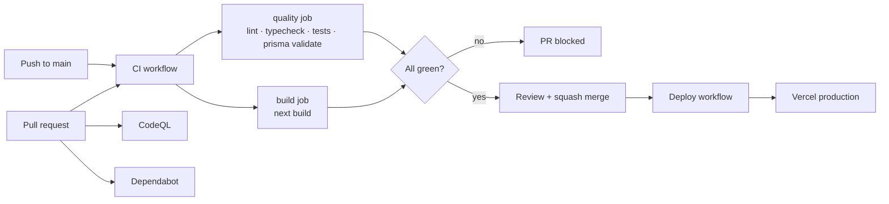

# CI/CD — Synthetix Engine

> What runs on every change, how production deploys, and which secrets you need.
> Companion: [GITFLOW.md](./GITFLOW.md) · [pull-request-guidelines.md](./pull-request-guidelines.md) · [CONTRIBUTING.md](./CONTRIBUTING.md)

---

## 1. Pipeline at a glance



| Workflow | File | Trigger | Purpose |
|---|---|---|---|
| **CI** | `.github/workflows/ci.yml` | push to `main`, PRs to `main`, manual | Lint, typecheck, tests, Prisma validation, production build |
| **Deploy** | `.github/workflows/deploy.yml` | after CI succeeds on `main`, manual | Optional Vercel CLI deploy + migrations |
| **CodeQL** | `.github/workflows/codeql.yml` | push/PR to `main`, weekly, manual | Static security analysis |
| **Dependabot** | `.github/dependabot.yml` | weekly | Dependency + Actions update PRs |

---

## 2. CI jobs (required checks)

Both jobs must pass before a PR can merge. They run in parallel.

### `quality`

1. `actions/checkout`
2. `actions/setup-node` (Node 20, npm cache)
3. `npm ci` — lockfile-exact install
4. `npx prisma generate`
5. `npx prisma validate` — schema is syntactically valid and has a URL
6. `npm run lint`
7. `npm run typecheck`
8. `npm test` — Vitest (71 tests)

### `build`

1. checkout + Node 20 + npm cache
2. `npm ci`
3. `npm run build` — Next.js 16 production build

> The build works without real vendor credentials because the app uses lazy
> singletons (`getEnv`, `getPrisma`, `getAuth`). CI supplies safe placeholders
> when repository secrets are missing, so forks and first-time contributors get
> a meaningful green/red signal without access to secrets.

### Run the same gates locally

```bash
npm ci
npx prisma generate
npx prisma validate
npm run lint
npm run typecheck
npm test
npm run build
```

---

## 3. Continuous deployment

There are two supported deployment paths. Pick one — they do not conflict.

### Path A — Vercel Git integration (default, zero config)

1. Connect `Ankitbhalke137/synthetix-engine` to the Vercel project.
2. Add environment variables in **Vercel → Settings → Environment Variables**
   (§5 below).
3. Every push to `main` deploys automatically; PRs get preview deployments.

The `Deploy` workflow detects that `VERCEL_TOKEN` is absent and exits with a
notice instead of failing.

### Path B — Vercel CLI deploy from GitHub Actions (opt-in)

Add these repository secrets (**Settings → Secrets and variables → Actions**):

| Secret | Required | Purpose |
|---|---|---|
| `VERCEL_TOKEN` | yes | Vercel personal token — enables the CLI deploy |
| `VERCEL_ORG_ID` | optional | Defaults to `team_AT3k3mxRkz5eJ3OHOuvBgmYN` |
| `VERCEL_PROJECT_ID` | optional | Defaults to `prj_ZLr1JMmcJHBxsKxptMUhjh21VR8b` |
| `DIRECT_DATABASE_URL` | optional | Direct (non-pooled) Neon URL used for migrations |
| `DATABASE_URL` | optional | Fallback migration URL when `DIRECT_DATABASE_URL` is absent |

The workflow then:

1. Waits for the **CI** workflow to succeed on `main`.
2. Runs `prisma migrate deploy` if a migration URL secret exists.
3. `vercel pull --environment=production`
4. `vercel build --prod`
5. `vercel deploy --prebuilt --prod`

> **Migrations:** use a direct Neon connection string for `DIRECT_DATABASE_URL`.
> The pooled URL is correct for runtime but can be unreliable for long
> migrations.

---

## 4. Branch protection (`main`)

The ruleset `main-protection` enforces:

- Pull request required before merge.
- Required status checks: **`quality`** and **`build`**.
- Linear history; no force-pushes; no branch deletion.
- **Squash merge only.**
- Admins may bypass for emergencies (hotfixes still get a retroactive PR).

Contributor checklist for every PR:

- [ ] Branched from updated `main`
- [ ] Conventional Commit title
- [ ] ≤ 400 changed lines, one concern
- [ ] Docs and `.env.example` updated with code
- [ ] PR template filled, especially “How tested”
- [ ] CI green
- [ ] Branch deleted after merge

---

## 5. Runtime environment variables

Full descriptions live in [`.env.example`](../.env.example). The table below is
for CI/deployment configuration.

| Variable | Scope | Notes |
|---|---|---|
| `BETTER_AUTH_SECRET` | server | ≥ 32 random bytes; rotate on leak |
| `BETTER_AUTH_URL` | server | Must match the deployed origin exactly (`https://synthetix-engine.vercel.app`) |
| `DATABASE_URL` | server | **Pooled** Neon connection string (`ep-…-pooler`) |
| `DIRECT_DATABASE_URL` | CI only | Direct Neon URL for migrations (optional) |
| `NEON_STORAGE_ENDPOINT` | server | S3-compatible endpoint from the Neon console |
| `NEON_STORAGE_ACCESS_KEY_ID` | server | Scoped storage credential |
| `NEON_STORAGE_SECRET_ACCESS_KEY` | server | Scoped storage credential |
| `NEON_STORAGE_BUCKET_NAME` | server | `synthetix-recordings` |
| `NEON_STORAGE_REGION` | server | Match the endpoint region shown in the console (e.g. `ap-southeast-1`) |
| `LIVEKIT_API_KEY` | server | Token minting + moderation |
| `LIVEKIT_API_SECRET` | server | Server only |
| `NEXT_PUBLIC_LIVEKIT_URL` | client | Public WebSocket URL — not a key |
| `GROQ_API_KEY` | server | STT proxy only |
| `UPSTASH_REDIS_REST_URL` | server | Rate limiting |
| `UPSTASH_REDIS_REST_TOKEN` | server | Rate limiting |
| `GITHUB_CLIENT_ID` / `GITHUB_CLIENT_SECRET` | server | Optional P1 GitHub OAuth |

**Never** commit real values. `.env.local` is gitignored; `.env.example` is the
canonical template.

---

## 6. Fork and external contributions

- Fork PRs run CI **without repository secrets**. The workflow falls back to
  placeholder values, so lint, typecheck, tests, and build still run.
- Deployment never runs for fork PRs.
- Maintainers may ask you to rebase if `main` moved; required checks re-run on
  the updated branch.
- CodeQL runs on PRs and posts results in the Security tab.

---

## 7. Troubleshooting

| Symptom | Cause | Fix |
|---|---|---|
| `quality` fails on `prisma validate` | Missing `DATABASE_URL` | CI sets a placeholder; check you did not remove the env block |
| `build` fails with “secret missing” | A new env var was added without a placeholder | Add it to `ci.yml` with a safe fallback |
| `Deploy` shows “skipped” | `VERCEL_TOKEN` not set | Use the Vercel Git integration, or add the secret |
| Migration fails in CD | Pooled URL or DB asleep | Set `DIRECT_DATABASE_URL`; wake the Neon project |
| Required check never appears | Workflow file invalid or job renamed | Validate YAML; job names must be `quality` and `build` |
| PR cannot merge after update | Branch behind `main` | Update/rebase the branch |

---

## 8. Adding a new workflow

1. Keep the `name`, `on`, `permissions`, `concurrency`, and `timeout-minutes`
   blocks — they are the house style.
2. Use `actions/checkout@v4` and `actions/setup-node@v4` with `cache: npm`.
3. Do not echo secrets; do not pass secrets to third-party actions.
4. If it becomes a required gate, update the ruleset and this document.
