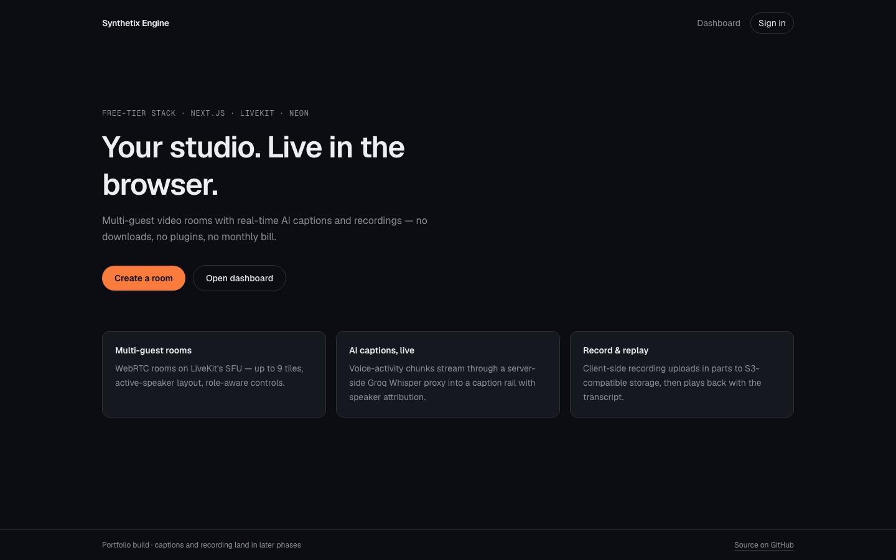
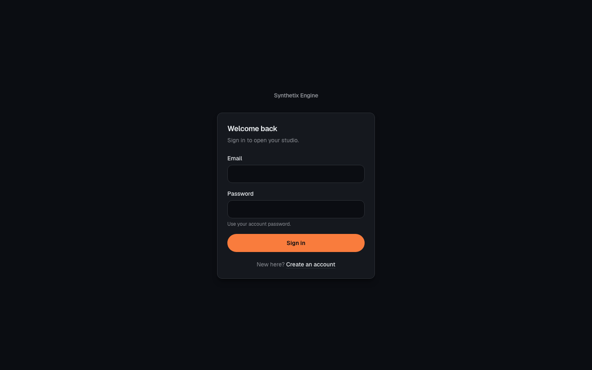

# LinkedIn Post — Synthetix Engine

> Ready-to-publish copy for LinkedIn. Convert this file to text / carry the image
> attachments across. Screenshots live in `docs/assets/screenshots/`.

---

## Post copy (paste this)

I built a live studio that runs entirely in the browser — and costs **$0/month** to operate. 🎙️

Multi-guest video. Real-time AI captions. Cloud recordings. No downloads. No plugins. No monthly bill.

**My goal** wasn't just to ship a demo app — it was to prove I can take a product from *“here's an idea”* to *“here's a running system with docs, tradeoffs, tests, and CI.”* A portfolio piece that shows engineering judgment, not just UI.

**The problem**
Remote interviews, podcasts, and demo calls need three things: multi-guest video, live captions, and a recording. Most stacks give you that for $50–200/month across five vendors. On free tiers, the usual move is to ignore the limits until they break you.

**The approach: design around the free-tier limits instead.**

A few decisions that shaped the build:
→ VAD-based audio chunks (8–12s, active speaker only) instead of naive 2s slices — Groq's 20 RPM + 10s minimum billing would have stalled on day one.
→ Client-side `MediaRecorder` + presigned multipart uploads — because LiveKit's free tier only includes 60 transcode-minutes.
→ Server-only STT proxy — the Groq key never touches the browser.
→ Quota preflight + a visible budget chip — LiveKit's free plan is a *hard* cap, so users see the budget before they hit it.

**Features**
• Email/password auth with sessions (Better Auth)
• Create a room → share a link → join with zero install
• Multi-guest WebRTC video (LiveKit SFU, active-speaker grid, up to 9 tiles)
• Real-time AI captions with speaker attribution (Groq Whisper)
• Transcript persistence + replay panel
• Client-side recording → Neon Object Storage, with playback
• Role-aware controls (host / moderator / participant / viewer)
• Rate limits + budget guardrails so the free tier never gets nuked

**What it's built with**
• Next.js 16 (App Router) + React 19 + TypeScript strict
• Tailwind v4
• Prisma 7 + Neon Serverless Postgres
• LiveKit Cloud (WebRTC SFU)
• Groq `whisper-large-v3-turbo` (STT)
• Neon Object Storage (S3-compatible)
• Upstash Redis (rate limiting)
• Better Auth
• Vercel Hobby (hosting)
• Vitest + GitHub Actions (70 tests + CI)

**The engineering part I'm proudest of**
The docs came first: a PRD, architecture + ADRs, RBAC matrix, design spec, security model, quality gates, and PR rules — *then* code, feature by feature, one branch → PR → squash-merge at a time. 29 PRs. Every PR passed typecheck, lint, tests, and a production build before merge.

The result: a product that actually runs on free tiers because the architecture respects their limits — and a repo that shows *why* every decision was made.

Live demo → https://synthetix-engine.vercel.app
Source → https://github.com/Ankitbhalke137/synthetix-engine

If you're hiring for full-stack / product engineering, I'd love to walk you through the tradeoffs. 👇

#WebDevelopment #Nextjs #TypeScript #WebRTC #AI #SystemDesign #FullStack #PortfolioProject #SoftwareEngineering #BuildInPublic

---

## Shorter variant (for a quick post / X cross-post)

I built a browser-based live studio — multi-guest video, real-time AI captions, cloud recordings — and it runs on a **$0/month** free-tier stack. 🎙️

My goal: prove I can take a product from idea → architecture → docs → tests → CI → deploy, not just build a UI.

Built with Next.js 16, React 19, TypeScript, Prisma 7, Neon, LiveKit, Groq Whisper, Neon Object Storage, Upstash, Better Auth, and Vercel.

The hard part wasn't the video — it was engineering around free-tier limits: VAD 8–12s audio chunks for Groq's rate limits, client-side recording to dodge LiveKit's transcode cap, and quota guardrails so the free tier never breaks.

29 PRs. Every one passed typecheck, lint, 70 tests, and a production build before merge.

Live → https://synthetix-engine.vercel.app
Code → https://github.com/Ankitbhalke137/synthetix-engine

#Nextjs #TypeScript #WebRTC #AI #SystemDesign #FullStack #PortfolioProject

---

## Screenshots

Save the files in this folder and attach them in this order on LinkedIn. The
first two are already captured from the live deployment.

**1. Landing page**

**2. Sign in**

| # | File | Caption |
|---|------|---------|
| 1 | `docs/assets/screenshots/01-landing.png` | ✅ Landing page — “Your studio. Live in the browser.” |
| 2 | `docs/assets/screenshots/02-login.png` | ✅ Auth — email/password sign-in (Better Auth) |
| 3 | `docs/assets/screenshots/03-studio.png` | ⬜ Studio — video grid + live captions rail + control bar |
| 4 | `docs/assets/screenshots/04-transcript.png` | ⬜ Transcript rail with speaker attribution |
| 5 | `docs/assets/screenshots/05-recordings.png` | ⬜ Recording playback / recordings list |
| 6 | `docs/assets/screenshots/06-budget.png` | ⬜ Budget chip + quota guardrail in the studio header |

### How to capture the studio screenshots (3–6)

1. Open https://synthetix-engine.vercel.app and sign up / log in.
2. Create a room from the dashboard, then open `/studio/<slug>`.
3. Join with a second browser tab (or a second device) as a guest so the grid
   has 2 tiles.
4. With the mic on, speak for ~10–15 seconds — captions appear in the rail after
   a Groq round-trip.
5. Capture the full studio window (1440×900 or larger).
6. Start a short recording, stop it, then open the recordings list for the
   playback screenshot.

> Tip: use Chrome's DevTools → “Capture full size screenshot” (⌘⇧P →
> “Capture full size screenshot”) for crisp images.

---

## Posting checklist

- [ ] Replace the `BETTER_AUTH_URL` demo link if the Vercel domain changes.
- [ ] Attach 3–6 screenshots (LinkedIn shows up to 9 in a carousel).
- [ ] Keep the first 2 lines strong — LinkedIn truncates after ~2 lines.
- [ ] Tag the tools you use (optional): @Vercel @Neon @LiveKit @Groq @Upstash.
- [ ] Add the repo link in the first comment if the post feels link-heavy.
- [ ] Proofread the “$0/month” claim — it's true at demo scale on free tiers.

---

## One-liner bio / resume blurb (bonus)

> **Synthetix Engine** — browser-based live studio (Next.js 16, TypeScript,
> WebRTC/LiveKit, Groq Whisper, Prisma/Neon, Neon Object Storage, Upstash).
> Multi-guest video, real-time AI captions, and client-side recordings on a
> $0/month free-tier stack. Docs-first build: PRD → ADRs → RBAC → tests → CI;
> 29 PRs, 70 tests, every merge gated by typecheck, lint, and a production build.
> Live: https://synthetix-engine.vercel.app · Code: https://github.com/Ankitbhalke137/synthetix-engine
