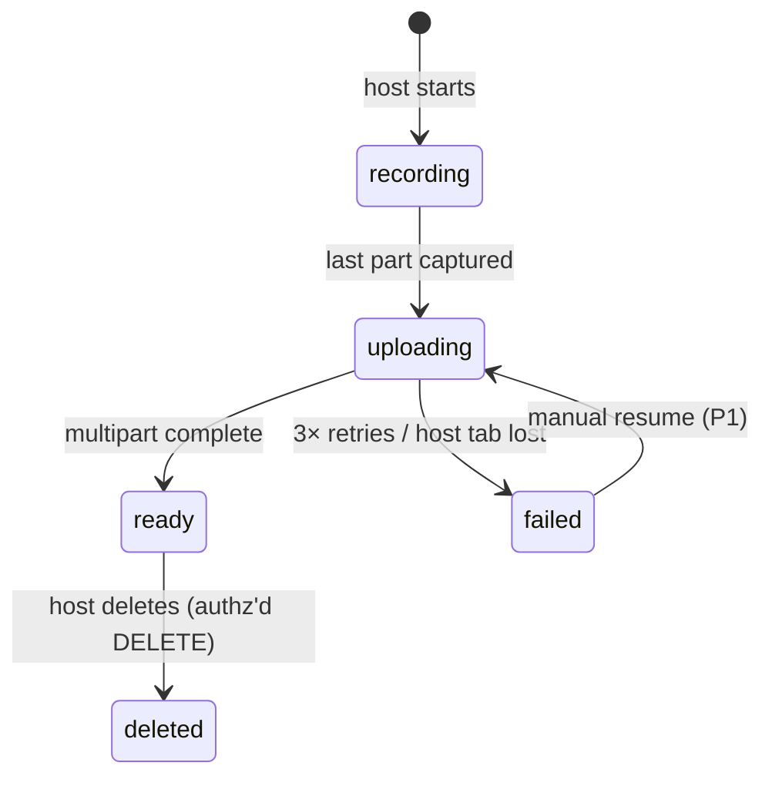

# Realtime Media Pipeline — Synthetix Engine

> Covers: mic capture → VAD → Groq STT → live captions, and recording → Neon Object Storage.
> Decisions referenced: [ADR-002/003/005/006](./architecture.md#4-architecture-decision-records). Limits: [Groq rate limits](https://console.groq.com/docs/rate-limits) (verified Nov 2026).

---

## 1. Goals & non-goals

**Goals:** captions ≤ 12 s behind speech (P0-4) · recording survives flaky networks · zero server-side media compute · degrade gracefully (captions fail ≠ call fails).

**Non-goals:** diarization ML · server-side composites · 4K · more than three simulcast layers.

## 2. Capture

```ts
// Implemented in lib/media-settings.ts — one contract for preview, room, recorder.
navigator.mediaDevices.getUserMedia({
  audio: {
    echoCancellation: true,   // browser WebRTC APM — replaces the cut DSP chain (ADR-008)
    noiseSuppression: true,
    autoGainControl: true,
    voiceIsolation: true,
    channelCount: 1,
    sampleRate: 48_000,
  },
  // High-DPI laptop screens deserve better than the browser's VGA default.
  video: { width: 1920, height: 1080, frameRate: 30 },
});
```

Rules:
- Device selection (mic dropdown) stored per user in `localStorage`.
- Permission denial → dedicated error state with OS-level guidance (never a blank grid).
- The **same** published mic track feeds the VAD worklet and (host only) `MediaRecorder`.
  Captions never call `getUserMedia` a second time.
- Publishing is explicit: 1080p primary + 720p/360p simulcast layers, VP8, Opus
  48 kbps mono, RED on, DTX off (DTX clips word onsets and makes recordings choppy).
- `adaptiveStream` picks 360p for grid tiles and 1080p for the active speaker, so
  quality follows the pixels on screen without spending bandwidth on hidden video.

## 3. AudioWorklet — meter + VAD only

Runs on the audio thread (`public/worklets/audio-processor.js`) — main thread never touches PCM (keeps 60 fps UI).

Responsibilities:
1. **Level meter:** RMS per 50 ms → `postMessage` → control-bar meter.
2. **VAD (energy-based):**
   - downsample input to 16 kHz mono PCM for STT consistency
   - frame energy vs adaptive noise floor (EMA of "silence" frames)
   - **speech start** after 3 consecutive voiced frames; **speech end** after 600 ms hangover
   - **emit a chunk when:** (speech ended AND chunk ≥ 6 s) OR chunk ≥ 12 s (max) OR silence flush at 15 s
3. Chunk assembly: WAV header + PCM payload, ~16 KB/s → **8–12 s ≈ 130–190 KB** (≪ Groq's 25 MB cap).

**Explicitly NOT in the worklet:** EQ, noise suppression, gain staging, resampling beyond 16 kHz (browser APM + `OfflineAudioContext` handle it — ADR-008).

### Why 8–12 s (the Groq math, binding)

| Groq free cap (whisper-large-v3-turbo) | Value |
|---|---|
| Requests per minute | 20 |
| Requests per day | 2,000 |
| Audio seconds per hour / per day | 7,200 / 28,800 |
| **Minimum billable duration** | **10 s per request** |
| Max upload | 25 MB |

- One continuous speaker at 2 s chunks needs **30 req/min > 20 RPM** → captions stall immediately (original blueprint's design — see README errata #2).
- 2,000 req/day × 10 s billed = 20,000 ASD ≤ 28,800 ✅, and at ~10 s real chunks that's **~5.5 h of speech/day**.
- Chunk floor of 6 s keeps RPM headroom ≥ 3× for multi-speaker turns.

## 4. STT proxy — `/api/stt/transcribe` (server only)

```ts
// request contract (zod-validated) — spec
const CaptionReq = z.object({
  roomId: z.string().uuid(),
  seq: z.number().int().nonnegative(),
  chunk: z.instanceof(FormData),      // wav blob, ≤ 2 MB enforced
});
```

Pipeline order (cheap checks first):
1. **Session** — Better Auth `getSession()`; 401 otherwise.
2. **Membership** — row exists in `RoomParticipant` for this `roomId`; 403 otherwise.
3. **Rate limit** — Upstash `Ratelimit` (per user: 12/min; per room: 20/min ≈ Groq RPM share).
4. **Quota** — room's daily chunk counter vs 2,000 global/day budget → 429 with `X-Quota-Exceeded` before touching Groq.
5. **Groq call** — `GROQ_API_KEY` **server-only** (`process.env`, never `NEXT_PUBLIC_`), model `whisper-large-v3-turbo`, `response_format=verbose_json` (segments for word timing).
6. **Broadcast** — publish caption frame via LiveKit server SDK (room-scoped data packet).
7. **Persist** — `Transcript.createMany` (fire-and-forget with error log; DB failure must not fail the request).

**429 handling:** honor `retry-after` → P0: drop chunk + log (call continues); P1: push `{roomId, wavBase64, seq}` into Upstash queue, drain with jittered backoff.

**Never:** call Groq from a client component; log audio contents; include `GROQ_API_KEY` in any response.

## 5. Caption frame protocol (DataChannel)

```jsonc
// server-authored only — client drops anything else
{
  "v": 1,
  "type": "caption",
  "roomId": "uuid",
  "seq": 42,                 // monotonic per room; client renders only seq > lastSeq
  "speaker": "participantId", // LiveKit identity — attribution, NOT diarization
  "speakerName": "Priya",
  "text": "…",
  "startMs": 184200,         // media timeline for replay alignment
  "endMs": 191050
}
```

- **Attribution:** whichever participant LiveKit reports as active speaker for that chunk window gets ownership (audio-level heuristics from the SDK). Documented limitation: two people talking over → single attribution (no diarization in Whisper output).
- **Untrusted peers:** the client renders *server* frames only (`seq` guard). Peer-spoofed frames are indistinguishable → ignore non-server packets by contract (server publishes under its own participant identity).
- **Replay (P0):** transcript rail hydrates last N rows from Postgres on join; DataChannel only carries live tail.

## 6. Recording pipeline

### 6.1 Capture (host only)

- Wrap the **already-published** LiveKit camera and mic tracks: `video/webm;codecs=vp9,opus`
  (fallbacks `vp8,opus` → `video/webm`). If the host has no camera, fall back to Opus audio.
- `start(timeslice = 1_000)` → buffer blobs until a part reaches the 5 MiB S3 floor,
  then upload sequentially. The tail is flushed on `stop`.
- Never call `track.stop()` on a LiveKit track — it belongs to the call.
- Unsupported browser → disable record button + tooltip (never break the call).
- UI contract: persistent "REC" indicator + "keep this tab open" warning (ADR-002 risk).

### 6.2 Upload — multipart presigned (direct to Neon Object Storage)

| Step | Detail |
|---|---|
| Init | `POST /api/storage/presigned/init {roomId, recordingId, mimeType}` → authz (host + live room) → `CreateMultipartUpload` → uploadId |
| Part URL | `POST /api/storage/presigned/part {recordingId, uploadId, partNumber}` → `UploadPartCommand` presigned, **15 min TTL** |
| Send | `PUT` directly from browser — **never through Vercel** (ADR-005) |
| Expired (403/410) | re-request the same `partNumber` URL, retry ×3 with backoff, then mark `failed` |
| Complete | `POST …/complete {parts:[{PartNumber, ETag}]}` → `CompleteMultipartUpload` → `Recording.status = ready` |
| Abort | room ended + 30 min without complete → `AbortMultipartUpload` (lifecycle rule, P1) + status `failed` |

**Object key convention:** `rooms/{roomId}/recordings/{recordingId}.webm` — a single multipart
object per recording, so playback is one presigned GET and deletion is one key.

### 6.3 States



**Playback:** `GET /api/storage/playback?id=` → membership check → 5-min presigned GET (Range-enabled for seeking). The DB stores `storageKey` only — never a URL (errata #4). The host opens `/dashboard/rooms/[roomId]` from an ended room card; the page lists ready recordings, mints a fresh URL on each Play, and replays the persisted transcript beside it.

## 7. Quota guard (P0-8)

Before join, client calls `preflight(roomId)` server action:

```
remainingParticipantMin = 5000 - usedThisMonth        (LiveKit meter, cached in Redis/DB)
projected               = participants + 1 × sessionMinutes(45)
if projected > remaining → block join with human message + reset date
```

- Same pattern for Groq: `chunksToday < 1500` (leave headroom) else captions auto-disable with a banner (call still works).
- Display a small budget chip in the studio header — honest quota UX is a PRD goal (G5).

## 8. Latency budget (target ≤ 12 s)

| Stage | Budget | Notes |
|---|---|---|
| VAD accumulation | 8–12 s | dominant; the only real knob |
| Encode + POST | < 300 ms | 190 KB on typical uplink |
| Groq round-trip | 0.3–1 s | turbo model |
| Broadcast + render | < 150 ms | DataChannel |
| **Total** | **~9–13 s** | meets PRD G1 (≤ 12 s p50) |

## 9. Testing hooks (see code-complexity-and-quality)

- **Unit:** VAD transitions (voiced/silence/hangover/max-flush), WAV encoder bytes, caption `seq` dedupe, quota math.
- **Integration:** STT proxy authz matrix (anon/peer/non-member/host) with mocked Groq (MSW), 429 path.
- **E2E smoke:** Playwright — join → assert caption frame renders from a mocked STT route.
- **Never** call real Groq/LiveKit in CI (cost + nondeterminism).
