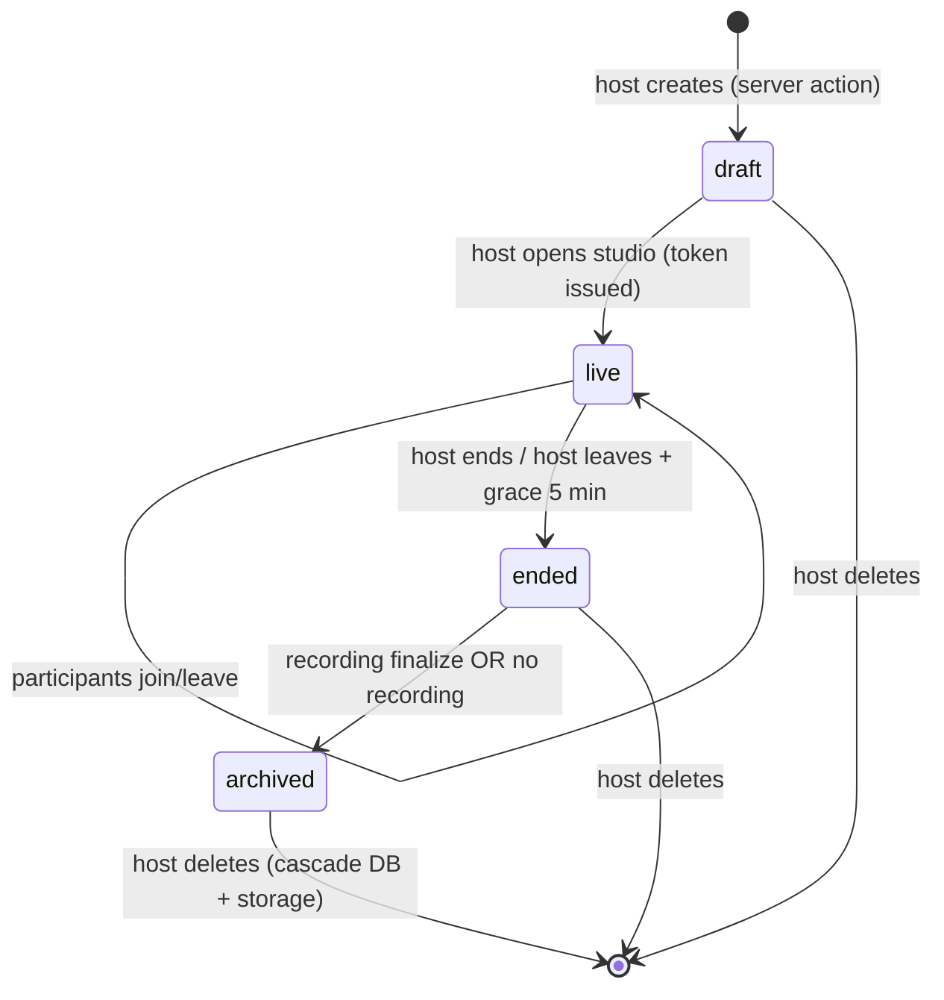

# Rooms, Roles & RBAC — Synthetix Engine

> Who can do what, where it's enforced, and how a room lives and dies.
> Companion: [`database-and-security.md`](./database-and-security.md) (schema) · [`realtime-media-pipeline.md`](./realtime-media-pipeline.md) (enforcement in flows)

---

## 1. Roles

| Role | Who holds it | Granted by | Scope |
|---|---|---|---|
| **host** | Room creator (`Room.hostId`) | Creating the room | That room only (no global admin in demo) |
| **moderator** | Trusted co-host, invited by host | Host action, persisted in `RoomParticipant.role` | That room |
| **participant** | Authenticated guest (or display-name guest) | Joining | Publish A/V, speak, receive captions |
| **viewer** | Read-only share-link visitor | P1 feature flag | Subscribe + read transcripts, no publish |

There is **no platform-wide admin** in the demo scope — deliberate (PRD non-goal). Every permission is room-scoped; the schema mirrors this (`RoomParticipant.role`).

## 2. Permission matrix

Rows = capability, columns = role. ✅ allowed · ❌ denied · 🔶 P1.

| Capability | host | moderator | participant | viewer |
|---|---|---|---|---|
| Create room | ✅ (any authed user) | — | — | — |
| Join room (A/V) | ✅ | ✅ | ✅ | 🔶 (listen-only) |
| Publish camera/mic | ✅ | ✅ | ✅ | ❌ |
| Speak (audio) | ✅ | ✅ | ✅ | ❌ |
| Send captions to rail | ✅ | ✅ | ✅ (own) | ❌ |
| Read live captions/transcripts | ✅ | ✅ | ✅ | ✅ |
| Mute another participant | ✅ | ✅ | ❌ | ❌ |
| Remove (kick) participant | ✅ | ✅ | ❌ | ❌ |
| Promote/demote moderator | ✅ | ❌ | ❌ | ❌ |
| Start/stop recording | ✅ | 🔶 (P1) | ❌ | ❌ |
| End room for everyone | ✅ | ✅ | ❌ | ❌ |
| Edit room name/settings | ✅ | ❌ | ❌ | ❌ |
| Download recording | ✅ | 🔶 (P1) | ❌ | ❌ |
| Delete recording | ✅ | ❌ | ❌ | ❌ |
| Delete room (cascade) | ✅ | ❌ | ❌ | ❌ |
| View audit log | ✅ | ❌ | ❌ | ❌ |

## 3. Enforcement — three layers (defense in depth)

```
Layer 1  Server (authoritative)     server actions / route handlers check RoomParticipant.role
Layer 2  Token claims               LiveKit JWT carries { role, roomId } — server API rejects
                                     out-of-policy room operations (mute/kick via server SDK)
Layer 3  Client UI (cosmetic)       buttons hidden/disabled by role — UX only, NEVER security
```

Rules:
1. **The client is not a security boundary.** Every deny in Layer 3 must already exist in Layer 1 (test: call the action directly with curl → expect 403).
2. **All moderation mutations go through server actions** that: verify session → verify membership → verify role → write `AuditEvent` → call LiveKit server API → revalidate.
3. **LiveKit tokens are minted only by `/api/livekit/token`** with claims `{ identity: userId, name, role, room: slug }`, TTL ≤ 2 h; refresh on reconnect.
4. **Guests (no account)** get `userId = null` rows with `displayName`; they act as `participant` — promotion possible only while `userId IS NULL` is disallowed for moderator (auditability requires a real user).

## 4. Room lifecycle



| Transition | Trigger | Side effects |
|---|---|---|
| `draft → live` | Host opens `/studio/[slug]` first time | LiveKit room created (auto via SDK), quota preflight runs |
| `live → ended` | Host ends (button) or host absent > 5 min | Participants kicked via server API; recorder stopped client-side; `endedAt` set |
| `ended → archived` | `complete` upload received OR 10 min timeout without parts | Playback row `ready` (or no-recording state); transcript rail read-only |
| `→ deleted` | Host confirms delete | Cascade DB rows + storage prefix delete; slug retired (410 on rejoin) |

Edge rules:
- **Host leaves ≠ room ends** while other participants remain (5-min grace covers refreshes). Ending without a host is impossible → no orphaned moderation.
- Rejoining an `archived` room → read-only transcript/playback view, no new A/V.
- Slugs are unique and never reused after deletion.

**Implemented** (`lib/rooms.ts`):
- `createRoom()` — draft room + host membership, readable slug with random suffix (retries once on a rare collision); persistence sits behind the `RoomStore` port (`prismaRoomStore` is the only SQL-aware adapter)

## 5. Moderation operations (server action contracts)

| Op | Input | Checks | Effects |
|---|---|---|---|
| `muteParticipant` | `roomId, targetId, persistent: bool` | actor ∈ {host, moderator}, target ≠ host | LiveKit `muteTrack` API + optional `mutedUntil` (P1); `AuditEvent` |
| `kickParticipant` | `roomId, targetId` | actor ∈ {host, moderator}, target ≠ host | LiveKit `removeParticipant`; `leftAt` set; `AuditEvent` |
| `promoteModerator` | `roomId, targetId` | actor = host, target is member with `userId != null` | role update; token refresh signal; `AuditEvent` |
| `endRoom` | `roomId` | actor ∈ {host, moderator} | state → `ended`, mass disconnect, `AuditEvent` |
| `deleteRecording` | `recordingId` | actor = host | status → `deleted`, storage prune queued, `AuditEvent` |

All ops are idempotent (repeat → no-op, 200) and audited. Targets are resolved **through membership**, never by raw client-supplied user id alone.

## 6. Token claims (LiveKit JWT payload)

```jsonc
{
  "sub": "userId|guest-uuid",
  "name": "Priya",
  "identity": "userId",
  "video": { "room": "slug", "join": true, "canPublish": true, "canPublishData": true },
  "metadata": "{\"role\":\"host\",\"roomId\":\"…\"}",
  "exp": 7200   // ≤ 2h
}
```

- `canPublish: false` for viewer (P1) — enforced by SFU, not UI.
- `metadata.role` is what the client reads for Layer 3; server re-derives from DB for Layer 1 (never trust the token for authorization decisions *about the token holder's own mutations* — re-check DB).

**Implemented** (`lib/livekit.ts` + `lib/room-policy.ts`):
- `mintRoomToken()` signs with `LIVEKIT_API_KEY`/`LIVEKIT_API_SECRET`, `ttl = 7200` (`TOKEN_TTL_SECONDS`), `metadata = { role, roomId }`
- grants: `roomJoin`, `canSubscribe: true`; `canPublish`/`canPublishData` = role policy (false only for `viewer`)
- `lib/room-policy.ts` is the single capability matrix (`can(role, capability)`) shared by token grants and future server actions; roles are parsed with zod, never cast
- token tests decode the JWT and assert claims, TTL and HMAC signature without contacting LiveKit

## 7. Audit log

`AuditEvent(roomId, actorId, action, targetId, metadata, createdAt)` — append-only, host-visible (P1 UI), 90-day retention (database-and-security §8). Interview talking point: *moderation without accountability is just an API with a kick button.*

## 8. Test matrix (RBAC exit criteria)

| Case | Expected |
|---|---|
| anon → join token route | 401 |
| participant → `muteParticipant` | 403 + no LiveKit call |
| moderator → `promoteModerator` | 403 |
| host → mute another host (second room host, cross-room) | 403 (not a member) |
| participant A → mutate room of member A | 401/403 per auth (session valid, role check fails) |
| guest (`userId null`) → promote | 403 |
| every denied path | no `AuditEvent` row with `action` written as success |
| every allowed path | exactly one `AuditEvent` row |
